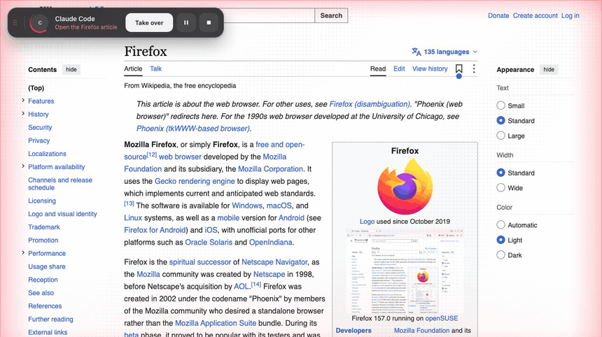
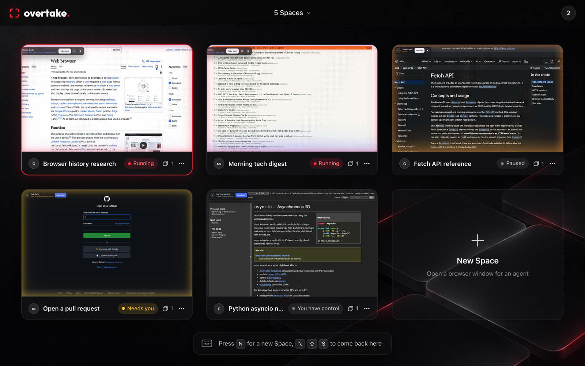
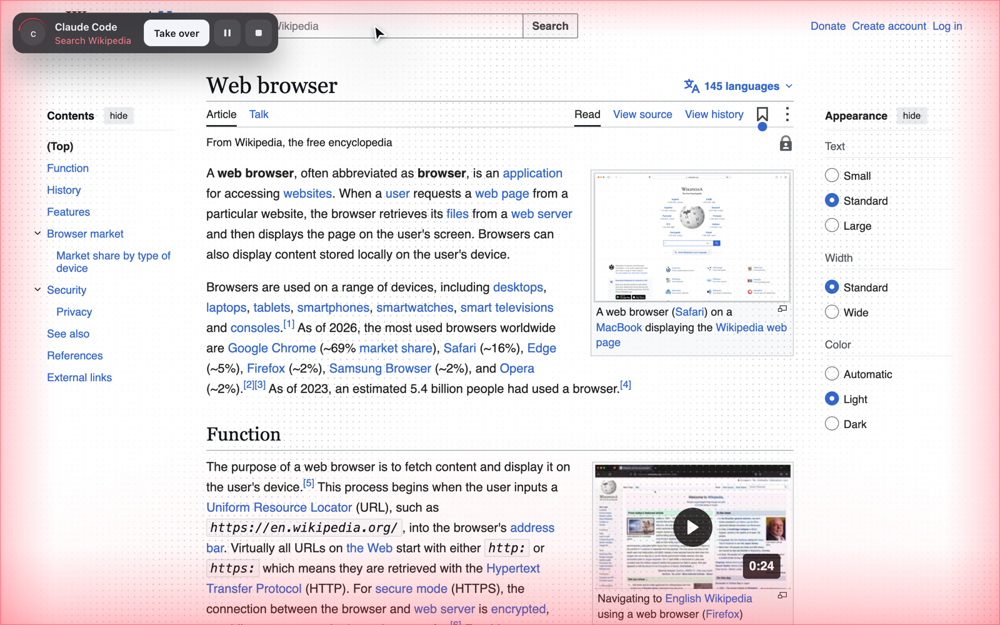
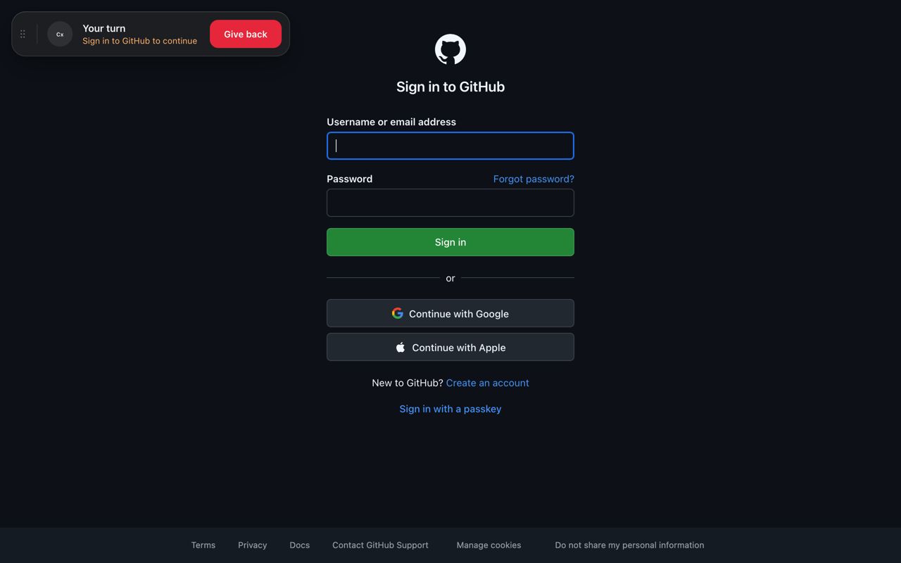
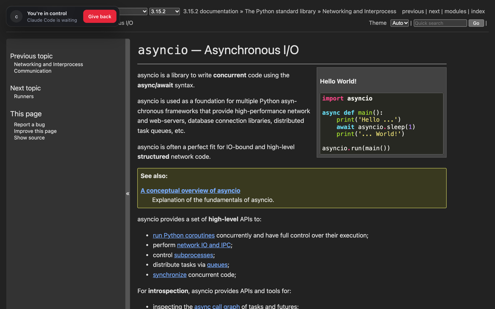
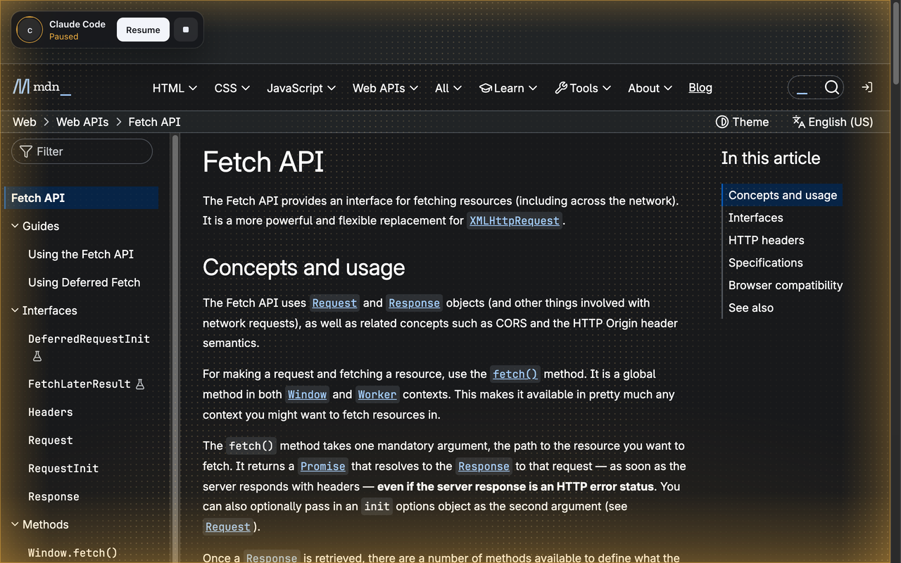
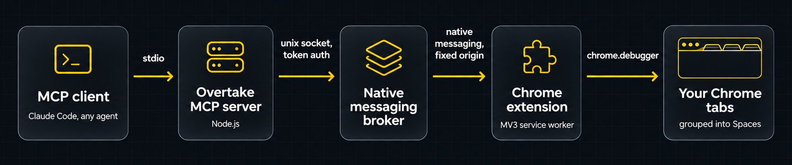

<p align="center">
  
</p>

<p align="center">
  <b>Open-source agent workspaces for your existing Chrome.</b>
</p>

<p align="center">
  <a href="LICENSE"></a>
  
  
  
  
</p>

<p align="center">
  <a href="#quick-start">Quick start</a> |
  <a href="#tools">Tools</a> |
  <a href="#how-it-works">How it works</a> |
  <a href="#performance">Performance</a> |
  <a href="#security">Security</a> |
  <a href="docs/architecture.md">Architecture</a>
</p>

<p align="center">
  
</p>

> [!NOTE]
> **Early preview.** Overtake runs on macOS with Google Chrome only, and its tools and UI may still
> change between versions. Bug reports and feedback are welcome in
> [Issues](https://github.com/morunai/overtake/issues).

## What is Overtake?

Overtake lets an AI agent drive **the Chrome you already use**, with your logins and sessions,
without taking the browser away from you.

Each task runs in a **Space**: a dedicated Chrome window that the agent owns. You can watch it
work, take over at any moment, and hand control back when you are done. Your other windows and
tabs are never touched.

It works with Claude Code or any other MCP client, and needs no Chromium fork and no
remote debugging port.

## Features

- **Your real browser.** Agents work inside your own Chrome profile, so sites you are signed in
  to just work. An optional isolated profile is available when you want a clean identity.
- **Spaces.** One window per task, with an overview page of live previews for every Space.
- **Explicit control.** Take over, pause, resume, stop and give back from a dock on the page,
  the toolbar icon or a hotkey. Human input is blocked while the agent drives, and agent
  commands are refused while you drive.
- **Hand-off.** The agent can ask you to step in for logins, CAPTCHAs and 2FA, then continue
  where it left off.
- **Full automation.** Accessibility snapshots with `@refs`, trusted input, screenshots,
  network, console, request interception, emulation, tracing, a JS debugger, file upload,
  downloads, popups and validated raw CDP.
- **Multiple agents.** Several agents can work at once, each in its own Space.
- **Visible activity.** An agent cursor, click ripples and a soft edge light show what the agent
  is doing. They are hidden from the agent's own screenshots.
- **Local and authenticated.** No network listener. The agent bridge uses a token-protected
  unix socket and Chrome native messaging.

<p align="center">
  
  <br><sub>The Spaces overview: every task in its own window, with a live preview, its state and who is driving it.</sub>
</p>

| Agent at work | Needs you | You have control | Paused |
|---|---|---|---|
|  |  |  |  |

## Quick start

Requirements: macOS, Google Chrome 125 or later, Node.js 24 or later.

```bash
git clone https://github.com/morunai/overtake.git
cd overtake
npm install
npm run install:host
```

`install:host` builds the extension into `dist/extension`, registers the local broker with
Chrome and writes `.mcp.json`.

1. Open `chrome://extensions`, turn on **Developer mode**, click **Load unpacked** and select
   `dist/extension`.
2. Start Claude Code in this folder and approve the **overtake** MCP server. To use it from any
   folder:
   ```bash
   claude mcp add --scope user overtake -- node "$PWD/mcp/server.ts"
   ```
3. Click the Overtake toolbar icon to open the Spaces overview. The header shows whether the
   bridge is connected.

Then ask your agent something like:

> Open a Space, go to localhost:3000, log in with the test account and check the checkout total.

### What the installer changes

- `~/.overtake/`: the access token (mode 0600), the bundled broker, the socket directory and logs.
- `~/Library/Application Support/Google/Chrome/NativeMessagingHosts/dev.overtake.broker.json`.
- `.mcp.json` in this repository.

Run `node scripts/install.mjs --uninstall` to remove the native host registration.

### Isolated profile (optional)

Spaces share your Chrome profile. For separate cookies and logins, start a dedicated Chrome
process with its own profile and the same extension:

```bash
node scripts/isolated-chrome.mjs research
```

It prints the `claude mcp add` command for that instance.

## Tools

| Area | Tools |
|---|---|
| Spaces and control | `spaces_list` `spaces_create` `spaces_close` `spaces_switch` `spaces_rename` `space_claim` `space_release` `space_handoff` `space_resume` `space_wait_for_control` `space_status` `space_mark_error` |
| Tabs and navigation | `browser_tabs` `browser_navigate` `browser_wait` |
| Observation | `browser_snapshot` `browser_screenshot` `browser_evaluate` `browser_network` `browser_console` `browser_events` `browser_frames` |
| Input | `browser_click` `browser_hover` `browser_type` `browser_select` `browser_press` `browser_scroll` `browser_drag` `browser_dialog` |
| Files and popups | `browser_upload` `browser_downloads` (popups opened by a click join the agent's Space) |
| Scripts | `browser_run` (a whole flow from one script file; each call uses the same real input and checks) |
| Advanced | `browser_intercept` `browser_emulate` `browser_trace` `browser_debug` `browser_cdp` `browser_capabilities` |

`browser_click`, `browser_type`, `browser_select`, `browser_press`, `browser_drag`,
`browser_navigate`, `browser_wait` and `browser_run` take `snapshot: true` to also return a
snapshot of the page after the action, with fresh `@refs`, so the agent does not need a separate
`browser_snapshot` call.

To check that an action worked, the input tools take `waitForText` (for example `"Saved"`): it
waits for that text to appear because of the action, so a "Saved" left over from an earlier save
does not count. Their results also list the requests the page made (method, URL, status), and
include the page URL and title only when they changed, so apps that keep long state in the URL
do not repeat it after every click. Snapshots mark native drag sources `[draggable]` and give
them `@refs`.

Apps that put their UI in iframes (cloud consoles, embedded editors) work like any other page.
Selectors (CSS, `text=`, `xpath=`) search the top document first, then same-origin iframes, then
cross-site ones. `browser_wait` checks every frame, and snapshots follow nested iframes.
`browser_type` clears and reads the focused field wherever it is. It returns that field's value,
capped in length, or `null` when focus is not on a text field.

Screenshots are in CSS pixels, the same units as click coordinates, also on HiDPI screens
(`hiDpi: true` gives device pixels). A viewport capture of a pinch-zoomed page is left as it is,
so the zoom is not reset, and its `scale` says how to convert. `browser_evaluate` awaits a returned Promise, so an async
IIFE returns its value.

The server ships instructions that tell the agent how to behave: one Space per goal, snapshot
before acting, treat `USER_IN_CONTROL` as a hard stop, and use `space_handoff` when a human is
needed.

### Human controls

| Control | Where |
|---|---|
| Take over, pause, resume, stop, give back | The dock on every Space tab |
| Move the dock | Drag the grip on its left edge; it stays where you put it |
| Open the Spaces overview | Toolbar icon, or `Alt+Shift+S` |
| Take over or give back | `Alt+Shift+E` |
| New Space | `N` on the Spaces overview, or the **New Space** card |

## How it works

<p align="center">
  
</p>

The extension is the single authority. It owns the windows, the UI and the CDP connection, and it
checks Space ownership and control state before every agent command. Human input gating, the
overlay and the dock live in the page inside a closed Shadow DOM.

The UI is plain TypeScript and CSS with no framework runtime. See
[docs/architecture.md](docs/architecture.md) for the design and its trade-offs.

## Performance

We ran the same agent task against Overtake and against a popular CLI-driven AI browser, each
used the way its documentation recommends: one MCP call per action for Overtake, one batched
CLI call per observe and act round for the other browser.

| | Overtake | CLI-driven AI browser |
|---|---:|---:|
| Scripted task, 10 rounds (median) | **1.45 s** | 3.16 s |
| Page that pauses when unfocused | **1.36 s** | 3.20 s, needs a workaround |
| Real Claude agent, end to end | **41 to 56 s**, $0.37 per run | 75 to 82 s, $0.47 per run |
| Overhead per call | **0.5 ms** | about 120 ms |
| Click / navigating click / wait | **17 to 25 / 57 / 69 to 73 ms** | 21 to 26 / 90 / 103 ms |
| Snapshot / type / screenshot | 12 / 21 / 75 ms | **7 / 8 / 35 ms** |

Both completed every checkpoint. The task ran on a local copy of a quiz site, so absolute times
on real sites are higher. Only two real-agent runs were made per side. Method, raw
results and the harness are in [`bench/REPORT.md`](bench/REPORT.md).

## Security

- **No network listener.** The broker listens on a unix socket in an owner-only directory.
- **Token authentication.** Every connection must present a 256-bit token stored with mode 0600.
  It is compared in constant time and redacted from logs.
- **Origin restriction.** Chrome starts the broker only for the extension's fixed origin.
- **Per-session authorization.** Each agent can act only in the Spaces it owns.
- **CDP policy.** Profile-wide cookie access, cache clearing and browser shutdown are denied.
- **Secrets masked in network results.** `browser_network`, `browser_events` and raw
  `browser_cdp` results mask auth headers, cookie values, and token, password and API-key
  fields in URLs and bodies before they reach the agent.
- **`browser_evaluate` is not filtered.** It runs JavaScript with the page's own access, so it
  can read anything the page can (including non-HttpOnly cookies and local storage). Output
  filtering cannot make that safe; use the isolated profile for sites you do not trust.
- **Scripts stop when you take over.** `browser_run` ends a script the moment you take over, press
  Stop, or close the Space (Pause only holds it), and commands it had queued never run. It runs in
  a worker with only the browser API in scope; that scopes it, it is not a sandbox.
- **Your tabs stay yours.** Agents cannot touch tabs outside their Spaces, and tabs you open in
  a Space are kept when it closes.

Chrome shows its "is debugging this browser" bar while agent tabs are attached, and sites can
detect CDP. Overtake does not try to hide automation.

### Prompt injection

An agent that reads web pages can be manipulated by them. A page can contain hidden text written to
make the agent do something you did not ask for, and in a Space the agent acts with your real
logins. This applies to every browser agent, and Overtake cannot fully prevent it. To limit the risk:

- Use the [isolated profile](#isolated-profile-optional) for untrusted or unknown sites, so the agent
  has no access to your accounts.
- Keep tasks narrow, and watch Spaces that touch accounts with money, email or admin rights. You can
  take over or stop at any moment.
- Do not give the agent credentials in the prompt. Let it hand off to you for sign-in instead.
- Review what the agent did before you confirm anything important, such as a purchase or a message.

To report a vulnerability, see [SECURITY.md](SECURITY.md).

## Development

```bash
npm run build          # build the extension into dist/extension
npm run typecheck
npm test               # unit tests
npm run test:e2e       # end-to-end tests in real Chrome with a throwaway profile
```

The end-to-end suite launches your installed Chrome with a temporary profile, loads the extension,
starts the real broker and drives it through the real MCP server. Your own profile is never
used. Human actions are simulated as trusted mouse and keyboard events.

### Project layout

| Path | Contents |
|---|---|
| `extension/` | MV3 extension: service worker, overlay, dock, Spaces overview, popup |
| `bridge/` | Native messaging broker |
| `mcp/` | MCP server and automation engine |
| `shared/` | Protocol types shared by all parts |
| `scripts/` | Build, install and isolated profile scripts |
| `tests/` | Unit and end-to-end tests |
| `bench/` | Benchmark harness and results |

## Limitations

- The overlay and dock live inside the page, so they do not cover the omnibox, tab strip or
  DevTools. The toolbar icon and hotkeys always work as escape routes.
- `Profiler` and `HeapProfiler` are not available to extensions. Use `browser_trace` instead.
- Native HTML5 drags into or out of a cross-site iframe are cancelled with an error. Pointer-based
  drags there work.
- A cross-site iframe inside another cross-site iframe is not searched by selectors or followed
  by snapshots.
- While a Space window is covered and Chrome is not painting it, a frame nested inside a
  cross-site frame may have no size yet, so its elements count as hidden until the window paints
  (a screenshot makes it paint).
- Element screenshots inside a rotated or skewed iframe are cut to the iframe's bounding box, so
  they can include a little of the page around the iframe's corners.
- Commands to a tab run one at a time, so a frame that is busy running script delays the tab's
  next commands until it answers.
- Spaces end when Chrome closes and are not restored.
- Certificate errors cannot be bypassed from an extension. On an untrusted certificate (such as a
  local dev server) the agent gets `CERT_ERROR` and hands off; click **Advanced**, then **Proceed**
  once and Chrome remembers it for that site until it restarts. A trusted local certificate
  ([mkcert](https://github.com/FiloSottile/mkcert)) avoids the warning entirely.
- Other extensions' in-page frames (for example password manager menus) are removed from agent
  Spaces, because Chrome refuses to debug tabs that contain them. Your other tabs are unaffected.
- macOS only for now.

## Roadmap

- Restore Spaces across Chrome restarts.
- Per-frame input permits for cross-origin iframes.

## Contributing

Issues and pull requests are welcome. Please run `npm run typecheck`, `npm test` and
`npm run test:e2e` before opening a pull request, and describe how you verified the change.

## License

[MIT](LICENSE)
